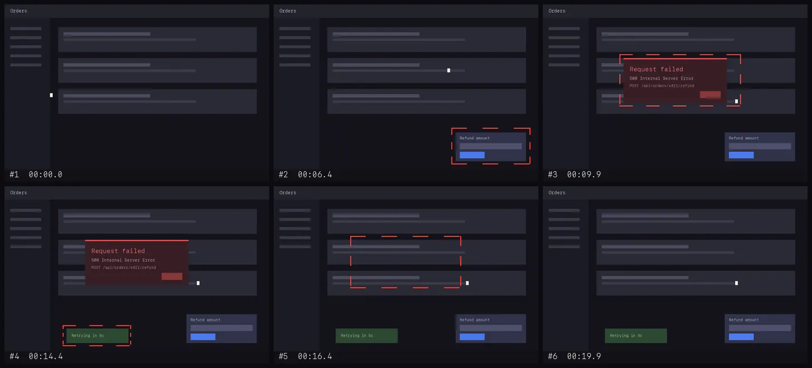
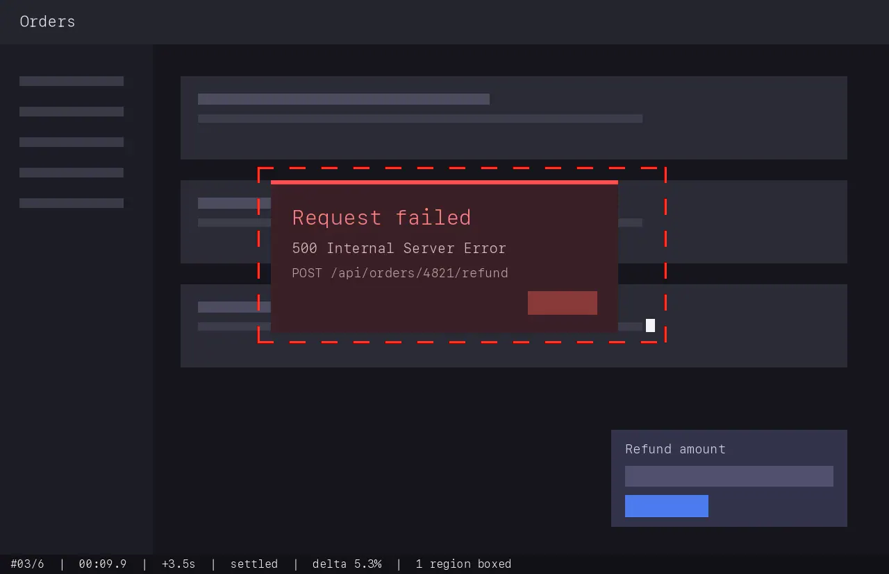

# vidin

**Turn a video into something a coding agent can actually read.**

Claude Code, Codex and friends accept images, not video. So when a bug report
arrives as a screen recording, the video is dead weight — someone has to watch
it and retype what happened. vidin watches it instead: it converts the
recording into a small set of annotated keyframes plus a written timeline, and
serves them to agents over MCP.



*A 20-second recording in, six frames out: the refund panel, the 500 dialog,
the retry toast, the recovery — each boxed and timestamped. (The clip is
vidin's synthetic test fixture.)*

- **Event-driven, not one-frame-per-second.** A frame is kept when the screen
  changes and then comes to rest. Three minutes of someone reading costs almost
  nothing; every real UI event is captured.
- **Fast.** A 3-minute 1080p recording takes ~4 seconds on an M-series Mac.
  An hour-long one costs time, not RAM.
- **One command to run.** `npx @teunlao/vidin` — all it asks of the machine
  is `ffmpeg`; no sharp, no headless browser, no native image library.
- **Shaped for agent context.** The MCP tools return a written report and one
  contact sheet first; full-detail frames only for the moments that turn out to
  matter.
- **Timestamps you can scrub to.** An agent can say "the error appears at
  00:41.2" and you jump straight there in the original file.

## Quickstart

```sh
brew install ffmpeg        # + yt-dlp, only if you'll pass URLs
```

Hook it into Claude Code:

```sh
claude mcp add vidin -- npx -y @teunlao/vidin mcp
```

Or in `.mcp.json` / `~/.codex/config.toml` equivalents:

```json
{
  "mcpServers": {
    "vidin": { "command": "npx", "args": ["-y", "@teunlao/vidin", "mcp"] }
  }
}
```

Or straight from the shell:

```sh
npx @teunlao/vidin ~/Desktop/bug.mov       # → ./.vidin/bug/
npm i -g @teunlao/vidin                    # or put `vidin` on PATH for good
vidin https://example.com/screencast.mp4   # downloaded with yt-dlp
vidin zoom bug.mov --from 00:41 --to 00:45 --fps 6
vidin probe bug.mov
```

## What comes out

```
out/
  REPORT.md        the entry point: timeline table, what changed where, what to open
  manifest.json    the same, machine readable
  sheets/          the whole video as labelled 3x3 grids (~1.3k tokens each)
  frames/          full-detail annotated frames
```



Each frame carries a **red dashed box** around the regions that changed since
the previous kept frame, and a **bottom bar** with the frame number, the
timestamp in the original video, the gap since the previous frame, why the
frame was kept, and how much of the screen changed.

## The MCP tools

Four tools, shaped so an agent spends context in the right order:

| tool | what it does |
|------|--------------|
| `analyze_video` | video → frames on disk; returns the report text **and one contact sheet image** |
| `get_frames` | full-detail frames by number or time range, capped so a call can't flood the context |
| `zoom_clip` | re-extract a narrow window at a higher frame rate — for the moment two frames don't explain |
| `probe_video` | duration / resolution / fps / audio, cheap |

The intended loop: analyse → look at the sheet → read the timeline → open two
or three frames → zoom in if the moment between them is still unclear. Opening
everything up front would burn the context before knowing which second matters.

## Profiles and tuning

| profile | for |
|---------|-----|
| `bug-report` | default — someone recorded a screen, narrated a bug, stopped |
| `dense` | short clips where every twitch matters (24 fps analysis, up to 80 frames) |
| `walkthrough` | long recordings; fewer frames, wider anchors |
| `cheap` | smallest footprint, for when the context really is tight (12 frames at 1092px) |

Tuning without leaving the profile: `--max-frames`, `--sensitivity` (percent of
the screen that counts as an event, lower = more frames), `--fps`, `--width`,
`--quality`, `--no-annotate`, `--no-sheets`.

## Why pick frames instead of slicing them

One screenshot per second turns three minutes into 180 frames of which ~90% are
identical, because the person was reading, thinking or moving the mouse. Those
duplicates don't cost much — they *bury* the handful of frames where something
actually happened, and an agent has to look at all of them to find out which.
Frame selection is a signal-to-noise problem wearing a cost problem's clothes.

vidin is event driven instead. It walks the video at 12 fps in downscaled RGB
and keeps a frame only when something actually happened:

- **Change is measured against the last *kept* frame**, not the previous
  sample, so slow drift accumulates instead of hiding under the threshold.
- **Frames land after the change, not inside it.** When motion starts, nothing
  is emitted yet — the selector waits for the screen to come to rest and keeps
  the settled frame. You get the state *after* the click, not the animation
  blur.
- **Colour counts as change.** Comparison is per channel, not on brightness. A
  field turning red or a green toast over a grey panel barely moves the luma
  and is exactly what a bug report is about.
- **A moving mouse costs nothing**, by arithmetic rather than special-casing:
  at analysis resolution a pointer is an order of magnitude below the event
  threshold. There was once a subsystem for recognising it; measured on real
  recordings it changed no decision anywhere, so it is gone.
- **Guard rails.** A minimum gap, anchor frames across long still stretches,
  periodic samples while a long animation runs, and a hard budget (40 frames by
  default) that drops the least informative frames first while keeping the ends
  of the timeline.

Two invariants hold whatever path a frame took:

- **Nothing is dropped silently.** The comparison baseline only ever advances
  by keeping a frame. There is no path that folds a changed screen into the
  baseline without emitting it — that would make the change unrecoverable,
  since every later comparison would measure zero against a state you never
  see.
- **Annotations describe the neighbour you can actually see.** After the frame
  budget prunes the middle of the timeline, every survivor's change percentage
  and boxes are recomputed against the frame that now precedes it.

## How it works

```
ffmpeg ─raw RGB @12fps, 400px─ selector ──timestamps+regions── ffmpeg ──annotated WebP
         one decode pass,         event state machine            drawbox/drawtext
         streamed                 in plain TypeScript            per frame
```

Decoding streams two frames at a time; the selector additionally keeps the
downscaled buffers of the frames it has kept so it can recompute their deltas
after pruning. That is bounded by the frame budget, not by video length: ~32 MB
at the defaults. All drawing is done by ffmpeg filters, which is why there is
no image library in `package.json`.

## Development

Development runs on [Bun](https://bun.sh); the runtime code itself sticks to
`node:` APIs, which is what lets the published package run anywhere `npx` does.

```sh
git clone https://github.com/teunlao/vidin && cd vidin && bun install
bun test
```

The fixture is a synthetic screen recording with a scripted timeline — a panel,
an error dialog, a toast, a recovery, and two stretches of pointer-only motion.
The suite asserts that each staged event yields exactly one settled frame and
that pointer motion alone yields none. `test/regressions.test.ts` builds its
own clips and pins every failure a review has found, so a fixed bug stays
fixed.

## Not there yet

- **Audio transcript.** Narration is the highest-signal part of a bug report.
  Planned: local Whisper (`whisper.cpp` or `mlx-whisper`) → a `transcript.md`
  aligned to the frame timeline.
- **OCR** over kept frames, so an agent can grep an error message without
  spending vision tokens at all.
- **Pointer position and clicks are not reported — deliberately.** A drawn
  crosshair was checked against a real recording and was right about half the
  time: a growing DevTools request list moves down the screen exactly like a
  pointer does. A wrong marker asserts "the user was pointing here" on a coin
  flip, and the pointer is plainly visible in the frame anyway.
- **Horizontal scroll** is not detected; vertical is.
- **Small elements need a nudge.** The default event threshold is 0.4% of the
  screen, so a progress bar or a badge below that is not an event on its own.
  `--sensitivity 0.2` or `--profile dense` catches them, at the cost of more
  frames.
